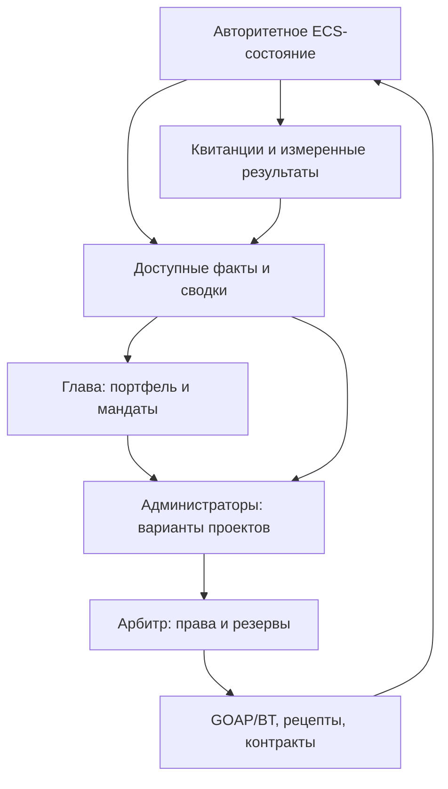

# Автономные фракции: архитектурный аудит и рекомендация

Дата: 2026-11-05. Проверенная база: `feature/genesis-faction-economy`,
`41b25864ad069b616ce256938160cefc09f640e0`. Рабочая ветка:
`feature/astra-strategy-architecture`.

**Результат P0: исходное ядро пригодно для продолжения, но пока не является
надёжной основой для автономного расходования стратегических резервов.**
Нужен новый слой управления над существующими исполнителями и исправление
нескольких общих экономических переходов. Новый симулятор не нужен.

Это завершённое исследование первого этапа, **предложение архитектуры**, а не
утверждённые игровые правила и не реализованный стратегический ИИ. Полный
контекст владельца остаётся в [ASTRA_START_HERE.md](ASTRA_START_HERE.md).
Исходники симуляции, seed, сохранения и поставляемый UI в этом этапе не менялись.

## Как читать результат

1. Этот файл: факты, расхождения, выбор подхода, границы переиспользования.
2. [ASTRA_DATA_CONTRACTS.md](ASTRA_DATA_CONTRACTS.md): данные, полномочия,
   резервирование, переходы, сохранения и наблюдение.
3. [ASTRA_GOAL_CATALOG.md](ASTRA_GOAL_CATALOG.md): 36 возможных целей,
   необходимые способности, физические результаты.
4. [ASTRA_VALIDATION_PLAN.md](ASTRA_VALIDATION_PLAN.md): причинные сценарии,
   отрицательные проверки и последовательность внедрения.

Метки: **Код** — проверено статически на указанном SHA; **Запуск** — выполненная
проверка; **Предложение** — инженерный выбор автора; **Неизвестно** — требует
исполнения или продуктового решения. Статический контрпример не означает,
что частота его возникновения измерена в игре.

## 1. Пять главных расхождений

1. **Готового главы нет.** `tick_factions` собирает налоги, спасает предприятия,
   публикует субсидии и запускает стройку по длительности дефицита. Нет
   стратегического портфеля, мандатов администраторов или рассмотрения нескольких
   способов устранить причину дефицита.
2. **Физические ограничения проверяются не на всех переходах.** Покупка и
   заправка меняют корабль до списания источника; списание ограничено нулём.
   Обычная шахта извлекает по богатству месторождения, не уменьшая его.
3. **Сохранение не доказывает продолжение того же процесса.** Стройплощадки уже
   сохраняются, но отправка dirty-записей может теряться; состояние исполнения
   корабельного BT и часть памяти после загрузки восстанавливаются неполностью.
4. **Экономическая статистика не равна наблюдению за исполнением.** Дефицит и
   история цен есть; причины простоя, выполненный спрос, резервы проектов и
   результат конкретного управленческого решения не представлены целиком.
5. **Часть комментариев отстаёт от кода.** GOAP уже использует поиск по стоимости
   и текущую топливную корзину; стройплощадки имеют SQLite-путь. Нельзя проектировать
   повторную реализацию этих возможностей по старым описаниям.

## 2. Проверенная карта исходников

Пути ниже относительны корню репозитория; символы точнее старых номеров строк.

| Область | Проверенные исходники и символы | Вывод |
|---|---|---|
| Запуск | `crates/sim_server/src/bin/genesis_server.rs`, `runtime.rs::run` | Genesis вызывает общий headless runtime; Bevy ECS task pool и SQLite остаются |
| Тик | `crates/sim_server/src/engine.rs::run_tick_loop` | Корабли → apply → facilities/populations/markets → apply → factions → публикация/сохранение; добавить управленческую фазу явно |
| Стратегическая реакция | `crates/sim_core/src/agents/faction.rs::tick_factions`, `run_construction_cycle` | Переиспользовать сведения и налоги; старый автоматический строительный триггер не должен конкурировать с новым главой |
| Utility | `crates/sim_core/src/ai/utility.rs::score_action`, `best_action` | Полезны оценки кандидатов; выбор одного победителя не решает портфель и бюджеты |
| GOAP | `crates/sim_core/src/ai/planner.rs::plan`, `Operator::cost` | Cost-weighted forward search, маленькое символическое пространство; оставить для кораблей |
| Интеграция GOAP | `crates/sim_core/src/agents/ship/behavior.rs::plan_goal` | Используется `fuel_fraction_to_bucket(fuel.fraction())`; есть отдельные кандидаты контрактов и торговли |
| BT | `crates/sim_core/src/ai/behavior_tree.rs::BtNode`, `Blackboard` | Сохранить локальное исполнение с Running/Success/Failure; Success пока иногда означает только отправку команды |
| Характер | `crates/sim_core/src/ai/personality.rs::Personality` | Шесть осей, prefer_goals, drift; не заменяют идеологию, срок полномочий и память государства |
| Производство | `crates/sim_core/src/agents/facility/mod.rs::tick_recipes_and_mining`, `economy/recipes.rs::execute` | Рецепты списывают текущий общий market supply последовательно; есть profitability gate, crew/fitting modifiers |
| Модули | `crates/sim_core/src/agents/facility/mod.rs::tick_produce_modules`, `economy/module_production.rs` | Производятся модули из материалов, не корпуса |
| Контракты | `crates/sim_core/src/economy/contracts.rs::ContractBoard` | Переиспользовать доску и жизненный цикл; усилить применение, идентификаторы связей и escrow |
| Дипломатия | `crates/sim_core/src/agents/faction_relations.rs::commerce_allowed` | Hostile/War — запрет; отдельного института переговоров глав это не создаёт |
| Стройки | `crates/sim_core/src/agents/construction.rs`, `sim_server/src/engine/apply.rs::apply_construction_delivery` | Есть площадка и материальная доставка; текущий commodity→facility_type не является универсальным строительным рецептом |
| БД | `crates/sim_db/src/{persistence,spawner,seeder}.rs`, `sim_server/src/engine/{persist,drains}.rs` | Есть persistence/load стройплощадок и контрактов; требуется общая согласованная граница фиксации |
| Наблюдение | `crates/sim_server/src/http/api.rs`, `engine.rs::record_command_trace`, `observer/{app,model}.js` | Реальные снимки и trace полезны, но не заменяют durable журнал решений/операций |

### Конкретные экономические и интеграционные долги

Все следующие пункты — **Код**, не выполненный Rust-тест.

| ID | Свидетельство | Следствие и необходимая проверка |
|---|---|---|
| F01 | `ship/actions.rs`, Buy: `want` зависит от кредита/трюма/qty и известной цены; груз добавляется сразу. `engine/apply.rs`, RemoveSupplyAtShipLocation: `(stock-qty).max(0)` | Даже один устаревший заказ может получить больше наличного товара. Два покупателя требуют общей атомарной проверки источника |
| F02 | `ship/actions.rs`, Refuel: топливо начисляется без чтения резервов; `apply_facility_refuel` ограничивает списание нулём | Пустой источник не препятствует начислению топлива. Нужен запрос и подтверждённый объём заправки, а не компенсация постфактум |
| F03 | `facility/mod.rs::tick_recipes_and_mining`, ветка mining_rig не меняет BodyResources; salvage_field меняет | Отключение regeneration не делает обычную добычу конечной. Богатство и физический запас надо разделить |
| F04 | `ship/actions.rs`, DeliverCargo проверяет только наличие location; apply вызывает mark_delivered до проверки владельца контракта, назначения и количества. `mark_delivered` проверяет Accepted/PickedUp | Повтор уже Paid блокируется, но неверный первый delivery может быть принят. Проверять fulfiller, cargo, dock, destination, отношения и escrow до всех мутаций |
| F05 | `engine/apply.rs`, DeliverContract: effective_payment увеличивается comms/treaty bonus без соответствующего дополнительного дебета в этой ветке | Определить плательщика бонусов и резервировать полную сумму; проверить путь оплаты и возврата при expiry |
| F06 | `construction.rs::facility_type_for_commodity`, `faction.rs::run_construction_cycle` | Доставка 600 единиц дефицитного товара создаёт сооружение. Gas→refinery и Water→farm не гарантируют производство запрошенного товара; не использовать это как универсальный planner |
| F07 | `engine/drains.rs::materialize_facility`: credits=20_000; `apply_construction_delivery`: absorbed=min(quantity,remaining) | Новому объекту начисляются деньги без указанного источника; остаток сверх потребности площадки явно не возвращается. Оба потока требуют учёта |
| F08 | `facility/mod.rs::recipe_input_commodities` расходится с RECIPES: refinery не запрашивает Ice; factory — Water/Components, зато запрашивает Ice; farm дополнительно Fuel | Выводить производственные потребности из активных рецептов. Сервисный Fuel учитывать отдельно, не выдавать за вход grow_food |
| F09 | `market.rs::tick_one_market`: consumption_window получает заданное amount даже при меньшем остатке | Нельзя считать текущую demand доказательством фактически удовлетворённого спроса; разделить wanted, fulfilled и unmet |
| F10 | `market.rs` поддерживает прямое MarketFlow.production; `population.rs` — production_commodity | В Genesis market production пуст, население отсутствует; эти upstream-пути всё равно нужны в аудите перед расширением seed |
| F11 | `engine/persist.rs`: try_send игнорируется, dirty очищается; `persistence.rs` при flush error вынимает buffer без повторной постановки | Возможна потеря обновления при backpressure/ошибке БД. SQL transaction внутри flush есть, но это не атомарный снимок тика |
| F12 | `engine/drains.rs::drain_pending_materializations`: INSERT facility и последующий SiteDelete разделены | Сбой между ними может оставить площадку и объект. Требуются общий transaction и уникальная связь built_from_project |
| F13 | `sim_db/spawner.rs`: current_bt=None, last_plan_tick=0, recent_systems/route_performance пусты; fallback personality использует thread_rng | Полный replay/save equivalence не доказан. Новую стратегию нельзя объявить детерминированной поверх этого без оговорок |
| F14 | `facility/mod.rs` LOD пропускает рецепты без компенсации выпуска; `engine.rs` пересчитывает LOD по наблюдателям | Потенциальная зависимость выпуска от внимания камеры. Проверить A/B с разными observers; не давать стратегу считать это реальной потерей мощности |
| F15 | `facility/mod.rs::tick_restock` распределяет ограниченные деньги по HashMap; `faction.rs` собирает faction_ids из HashMap | Одинаковый seed ещё не фиксирует порядок конкурирующих решений. Нужны стабильные ключи, RNG и проверка восстановления |

Важная точность: **не все производства используют отложенный snapshot**. Рецепты
уже изменяют market supply последовательно; нельзя приписывать им проблему Buy.
Однако ни рецепты, ни restock пока не уважают стратегические резервации — добавление
одной таблицы резервов без подключения всех потребителей не защитит металл.

## 3. Выбор архитектуры

Сравнение — инженерный вывод для этого кода, не универсальный рейтинг алгоритмов.

| Подход | Где полезен | Ограничение здесь | Решение |
|---|---|---|---|
| Только Utility AI | Оценка привлекательности целей, характера и риска | Не строит зависимости, не защищает деньги и не согласует портфель | Оставить для предпочтений, запреты вынести из score |
| Один GOAP на всю фракцию | Поиск новых комбинаций действий | Количество количественных состояний/агентов/сроков раздувает поиск; текущие Loc/ShipAction специально узкие | Не расширять корабельный WorldState до всей цивилизации |
| HTN / сеть задач | Объяснимые альтернативные способы удовлетворить потребность | Методы пишутся разработчиком; один метод на цель снова станет сценарием | Ограниченная сеть общих методов у администраторов |
| Constraint/CP/MILP | Проверка расписаний, мощностей и конкурирующих резервов | Не выбирает ценности главы; точные прогнозы не гарантированы; новый runtime и поддержка | Сначала простой детерминированный allocator; solver позже как сравнительный offline oracle |
| Только реактивные правила/BT | Аварийная реакция и локальное исполнение | Слабая долгосрочная координация; существующий shortage→build показывает границу | Сохранить BT исполнителей и аварийные процедуры в рамках мандата |
| LLM или обученная policy в каждом главе | Возможное позднее экспериментальное объяснение/поведение | Стоимость, воспроизводимость, обучение, проверка полномочий; нет готовой модели мира | Не требуется для первого ядра; тексты объяснений строить из trace |

**Рекомендация:** проактивный Utility-портфель главы → ограниченное планирование
сети проектов администраторами → единый арбитр ресурсов → существующие GOAP/BT и
рецепты. Это новый управленческий слой в `sim_core`, не копия мира и не новый
корабельный планировщик.

### Что означает «проактивный»

Глава регулярно рассматривает **возможности**, даже если нет дефицита: доступный
маршрут с подтверждённым спросом, свободная мощность, известный ресурс или право
доступа. Генератор кандидатов работает только по разрешённым знаниям. Он может
выбрать исследование неизвестного, но не пользоваться скрытым результатом заранее.

Амбиция «экспансия» задаёт класс желаемых последствий. Администратор получает
перечень доступных возможностей и неудовлетворённых предпосылок. Если перевозка
осуществима имеющимися кораблями — расширяет обслуживание; если мешает доступ —
предлагает доступный дипломатический способ; если недостаточно знаний — разведку.
Если этих способностей пока нет, результат **blocked / unsupported capability**,
а не фиктивный рейс или автоматически построенные пять грузовиков.

### Портфель без универсального «процента развития»

1. Отобрать кандидатов с явными обязательствами, доступом, знаниями и возможными
   методами; unknown отличать от false.
2. Отделить физическую возможность от желательности. War не уменьшает балл
   торговли, а исключает конкретный легальный план.
3. Для каждого варианта хранить вектор: ожидаемый физический эффект, стоимость,
   время, риск, качество данных и издержки остановки.
4. Удалить доминируемые варианты при сопоставимых эффектах. Оценить оставшиеся
   предпочтениями идеологии/главы/истории; сами предпочтения — условность модели,
   а не «объективный интеллект».
5. Детерминированно собрать совместимый набор. Учитывать общие зависимости:
   одна доставка может помогать двум целям, но её материалы/эффект нельзя посчитать
   дважды. Для малого первого набора допустим ограниченный перебор портфелей.
6. Сохранять принятые обязательства. Пересмотр — при смене фактов, нарушении срока,
   риске критического запаса или устойчиво более выгодной альтернативе. Порог
   инерции калибруется экспериментом, не выдаётся за пожелание владельца.

Для первого эксперимента предлагаются 1–2 ключевые и до 2 второстепенных активных
целей, максимум 3 альтернативы на потребность. Это **ограничения эксперимента**, не
игровые константы. Каталог содержит 36 вариантов, а не 36 одновременно активных
процессов. Статус ключевой/второстепенной — свойство текущего портфеля, не вечный
тип цели: спасение топлива во время кризиса становится ключевым.

### Администратор не равен отдельному всесильному NPC

В первой версии это типизированный аналитический модуль с мандатом. Отдельный
ECS-компонент на каждый отдел не нужен, пока у него нет самостоятельного жизненного
цикла. Промышленный администратор диагностирует выпуск и входы; логистический
оценивает реальные перевозки. Оба предлагают проекты одному арбитру. Начальник
может отвергнуть проект с указанием альтернативы/риска, но не сделать невозможный
проект исполнимым приказом.

Методы общие: `satisfy_input`, `transfer_stock`, `schedule_recipe`,
`restore_existing_capacity`; позднее `acquire_access`, `survey`, `build_asset`.
Они перебирают реальные узлы, рецепты и исполнителей. Это предметные правила;
«универсальность» не означает отсутствие написанных разработчиком механик.

### Расширяемость и различия фракций

Новый домен добавляет capability с preconditions, проверкой доступа, оценкой,
командой исполнителю и измеримым postcondition. Наука потребует лаборатории,
времени и сохранённого результата; разведка — физического посещения и отчёта;
конвой — группы реальных заданий, общей точки сбора и политики потери участника.
Ни один из них не подключается только строкой в каталоге целей.

Общее ядро выбора одинаково для пиратов и обычной фракции. Различаются разрешённые
действия, доступные активы, сведения и профиль предпочтений. Воинственность не
создаёт пока отсутствующий боевой исполнитель. Смена главы меняет предпочтения,
но сохраняет фракцию, договоры, обязательства и память.

Одинаковое полное состояние и последовательность событий должны воспроизводиться.
Разные пути возникают из конкуренции, ограниченных знаний и отличий мира.
Случайный выбор допустим только среди допустимых вариантов, с сохраняемым seed/
потоком RNG и записью причины; случайность не заменяет цель.

## 4. Что считать успехом

Операционная сводка должна показывать единицы товара, окно измерения, источник и
полноту данных. Например, запас 300 и чистый расход 10 за условную единицу времени
дают прогноз 30 таких единиц **при сохранении режима**. При нулевом/отрицательном
чистом расходе конечного срока истощения нет; при неизвестных потоках прогноз
неизвестен. Длительность окна хранить в симуляционном времени, не в wall clock.

Не путать норму потребления с выполненным расходом: при пустом складе наблюдаемый
расход может быть нулевым именно из-за голода. Не суммировать локальные остатки как
один доступный резерв, если между ними нет своевременной перевозки. Перемещение
топлива из market в facility reserves и далее в бак — внутренние переводы, а не
добыча/потребление три раза. Стратегическое резервирование ограничивает доступность,
но само по себе не расходует товар.

Успех проекта подтверждается receipt реального действия и последующим наблюдением
результата: заказ доставлен, нужный рецепт использовал входы, обязательство
выполнено. Рост выпуска после проекта — наблюдаемая корреляция; чтобы приписать
прирост именно проекту, нужен контролируемый A/B-прогон с одинаковым исходным
состоянием и явно учтёнными изменениями других агентов.

## 5. Граница первой реализации

Сначала — F01/F02/F04 и учёт операций, затем интеграция резервов со **всеми**
потребителями выбранного товара, согласованное сохранение и узкий вертикальный
срез. До этого новый глава может работать в диагностическом режиме и предлагать,
но не распоряжаться ресурсами.

Не требуются сразу: новый общий язык планирования, полное event sourcing,
LLM-сервис, 40 обработчиков целей, моделирование выборов, все научные деревья,
боевая система, чужая цивилизация или новый frontend. Существующий движок остаётся.

### Текстуры и Observer

В этой ветке диагностический Observer уже рисует программные силуэты
(`drawFacilityHub`, `drawBody`, маркеры кораблей) без зависимости от PNG. Это
достаточное символическое отображение для P0. Красивый UI 0.14 с отсутствующими
текстурами находится в отдельном ZIP и **этим аудитом не проверялся**. Не менять
его вслепую и не объявлять текстуры восстановленными. При следующей интеграции
assets нужен fallback по фактическому типу, но appearance не должен менять роль.

## 6. Проверки и ограничения

**Запуск:** `node --test tests/genesis-seed.test.mjs observer/model.test.mjs` —
27/27 passed на этой базе. Они проверяют seed/адаптер, не физическую замкнутость.
**Не выполнены:** Rust tests, сборка сервера, Windows run, soak, save/restart:
в рабочей среде отсутствуют `cargo`/`rustc`. Предыдущий успешный Windows CI из
handoff не подменяет проверки нынешних выводов. Полный `make verify` не запускался.

Неизвестны частота дефектов в живом мире, производительность нового слоя и
настройки характеров/инерции. У архитектуры есть критерии опровержения в плане
проверок; её качество пока подтверждено разбором путей кода, не gameplay-прототипом.

## 7. Первичные источники для выбора подхода

Ни одна внешняя библиотека не добавлена. Ниже источники концепций; конкретная
комбинация и границы применения — вывод этого аудита.

- Nau et al., [SHOP2: An HTN Planning System](https://www.cs.umd.edu/~nau/papers/nau2003shop2.pdf),
  JAIR 20, 2003: декомпозиция, частичный порядок задач, альтернативные методы.
  Здесь заимствуется принцип сети, не реализация SHOP2 и не обещание готовой стратегии.
- Jeff Orkin, [Three States and a Plan](https://www.gdcvault.com/play/1013282/Three-States-and-a-Plan),
  GDC 2006: планирование и перепланирование поведения исполнителей. Это поддерживает
  сохранение существующего GOAP, не перенос боевого AI на экономику целиком.
- Kevin Dill, Dave Mark, [Improving AI Decision Modeling Through Utility Theory](https://gdcvault.com/play/1012410/Improving-AI-Decision-Modeling-Through),
  GDC 2010: response curves и предпочтения для выбора решений. Ограничения ресурсов
  в предлагаемой архитектуре остаются отдельными проверками.
- Google, [The Job Shop Problem](https://developers.google.com/optimization/scheduling/job_shop):
  precedence и исключительное использование мощности. Мотивирует явные временные
  ограничения; внедрение OR-Tools сейчас не предлагается.
