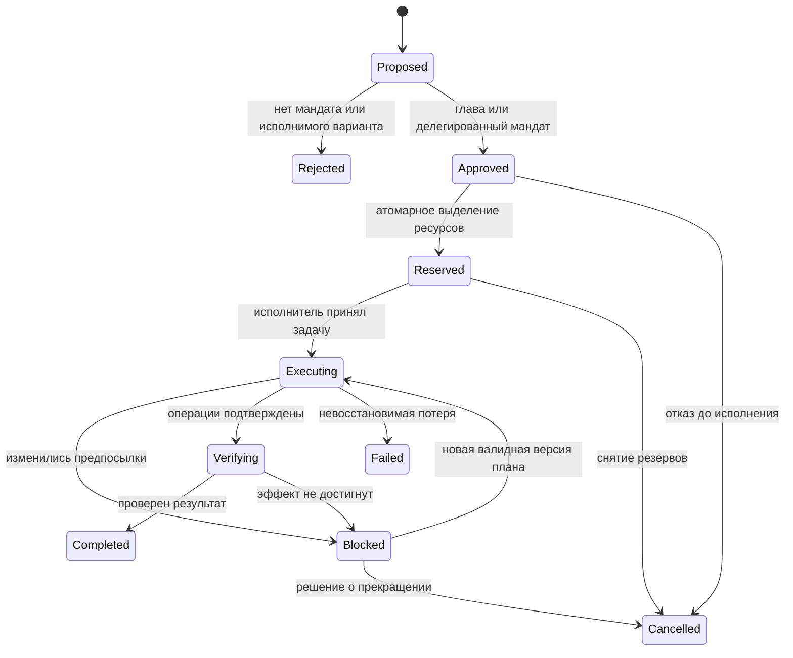

# Предложение контрактов стратегического слоя

Дата: 2026-11-05. База и факты — [аудит](ASTRA_ARCHITECTURE_REVIEW.md).
**Статус: проект интерфейсов, не существующие Rust-типы/API/миграции.**
В этой работе таблицы не создавались, сохранения не изменялись.

## 1. Владение данными

| Состояние | Авторитетный владелец | Что разрешено стратегу |
|---|---|---|
| Товар на рынке | Существующий MarketPricing.supply | Читать разрешённое наблюдение; запрашивать операцию через общий apply |
| Сервисные запасы объекта | FacilityStorage.reserves | Учитывать отдельно от рынка; перенос требует операции |
| Груз и бак | ShipCargo / ShipFuel | Не считать доступным другому проекту без перегрузки/доставки |
| Деньги | ShipEconomy, FacilityOperations, FactionData | Расходовать только собственный/делегированный счёт; предусмотреть market settlement account |
| Месторождение | Существующий BodyResources + будущий отдельный конечный запас | Богатство характеризует скорость, количество — предел извлечения |
| Контракт | ContractBoard | Создать запрос, отслеживать назначение/исполнение; не ставить Paid из UI |
| Цели/проекты/разрешения | Новый StrategyState в sim_core | Единственный владелец управленческих состояний |
| Резервации | Общий ReservationBook в sim_core | Ограничивают доступ, не дублируют физический остаток |
| Наблюдения | KnowledgeStore с областью видимости | Проекция фактов, никогда не второй склад/второй мир |
| История операций | Упорядоченные OperationReceipt | Аудит авторитетной мутации; receipt не должен сам повторно менять склад |
| БД | sim_db | Снимок и восстановление ECS/управления на одной подтверждённой границе |
| Observer | SnapshotCache/API | Только просмотр; не источник сведений для AI |

**Нерешённое владение общим рынком:** контроллер рынка и владелец каждого товара —
не одно и то же. Сейчас запас общий, полноценного учёта титула партий нет. Для
первого среза выбрать явно принадлежащий одной фракции узел и задокументировать
его права. Для смешанного рынка добавить ownership/claim к существующему запасу
или адресуемые subaccounts, причём сумма долей обязана равняться supply. Нельзя
дать главе резервировать весь товар только потому, что он контролирует станцию.

## 2. Идентификаторы, величины и версии

- Долгоживущие ссылки используют стабильные id, не Bevy Entity и не отображаемое
  имя. Entity разрешается через индекс при исполнении. Для проекта/задачи/операции:
  `(world_id, producer_id, persisted_sequence)`; конфликт идентификаторов — ошибка.
- Новый ресурсный контракт использует типы Quantity, Credits, SimTime. Credits —
  i64 с проверяемой арифметикой; Quantity — согласованная целочисленная базовая
  единица. Коэффициент масштаба надо выбрать на имеющихся рецептах, не молча
  округлять нынешние f32. До миграции f32 проверяются на finite/неотрицательность,
  все округления входят в receipt и допустимый числовой остаток.
- Не обещать сохранение массы между разными commodities: рецепты являются
  игровыми преобразованиями. Проверяется баланс **каждого** товара с указанными
  recipe inputs/outputs, источниками, расходами и потерями.
- В каждом сохраняемом документе: `schema_version`, `rules_version`,
  `world_id`, `snapshot_tick`. У изменяемого агрегата — `revision`.
- Время наблюдения, получения и дедлайн — раздельные поля. Цены/скорости без
  единицы и окна не допускаются. Игровой год пока не определяется этим проектом.

## 3. Типы и обязательные поля

| Предлагаемый тип | Обязательные поля / смысл |
|---|---|
| Observation | id, subject_id, fact_kind, typed_value, unit, observed_at, received_at, source_id, source_event_ids, visibility_scope, quality, valid_until |
| Aggregate | id, faction_id, metric, scope/node_ids, window_start/end, numerator, denominator, unit, completeness, observation_ids, method_version |
| Forecast | id, aggregate_ids, assumptions, horizon, interval_or_unknown, model_version; не выдаёт прогноз за наблюдённый факт |
| FactionDoctrine | faction_id, values, policy_constraints, version; устойчивее личности |
| LeaderProfile | leader_id, faction_id, traits, accession_time, tenure_policy_id; смена не удаляет фракцию |
| FactionMemory | event_id, subject_ids, outcome, learned_constraint, evidence_ids, relevance/expiry; память о событии, не произвольная прибавка «мудрости» |
| GoalDefinition | goal_key, domain, observable_outcomes, candidate_generator_key, required_capabilities, evaluator_version; расширяемый registry |
| GoalInstance | id, faction_id, definition_key, target_scope, key_or_secondary, desired_outcomes, baseline_observation_ids, status, review_due, commitment_policy |
| Mandate | id, issuer_id, faction_id, administrator_domain, allowed_actions, scope, spending_cap, time_window, protected_floor_policy, expiry, revision |
| ProjectProposal | id, goal_ids, proposer, alternative_ids, assumptions, dependencies, capability_ids, expected_outcomes, costs, risk, evidence_ids, valid_until |
| Project | id, proposal_revision, mandate_id, status, approved_budget, reservation_ids, task_ids, committed_operations, review_due, cancellation_policy |
| Task | id, project_id, capability_key, typed_args, dependency_ids, executor_requirements, assigned_executor_id, status, attempt, command_id, receipt_id |
| Reservation | id, project_id, mandate_id, source_account, commodity_or_credits, quantity, interval, state, expires_at, revision |
| CommandEnvelope | operation_id, task_id, attempt, expected_revisions, mandate_id, reservation_ids, payload_version, payload |
| OperationReceipt | operation_id, outcome, reason_code, actual_deltas, actor_ids, tick, before_after_revisions, source_command_id; отклонение тоже receipt |
| DecisionTrace | id, faction/leader, knowledge_revision, considered_candidates, rejected_reasons, utility_terms, chosen_project_ids, mandate_ids, policy_version |

`quality` вначале: direct / reported / estimated / unknown, плюс источник и возраст.
Число «доверие 0.8» не вводить без модели калибровки. Противоречащие сообщения
хранятся как отдельные наблюдения; последнее по времени не обязательно истинно.

## 4. Жизненный цикл

Цель: `candidate → active ↔ suspended → achieved | abandoned`. Для цели
поддержания (`maintain_supply`) кратковременное достижение нормы не завершает её:
она остаётся active и пересматривает проекты. Цель достижения (`restore_access`)
может перейти в achieved после подтверждённого условия.

Approved не даёт права немедленно тратить, Reserved не означает доставку,
BT Success не означает экономический receipt. У задачи состояния
`pending → offered → accepted → running → applied → verified`; альтернативно
`rejected/blocked/failed/cancelled`. Исполнитель может отказаться из-за маршрута,
топлива, оснащения или занятого трюма и обязан вернуть структурированную причину.

Прерывание Executing идёт через безопасную остановку/Blocked и расчёт уже
выполненных операций. Нельзя откатить сгоревшее топливо или вернуть погибший груз
простым снятием резерва. Возврат физического груза — новая задача, а не отрицание
прошлого. Cancelled хранит фактическую стоимость и незакрытые обязательства.

## 5. Резервирование и атомарное применение

Предлагаемый свободный ресурс в конкретном источнике:

`free = physical - active_claims - protected_floor`.

Должно быть определено, какие claims входят в protected_floor, чтобы не вычесть
один резерв дважды. Резервировать неизвестную будущую добычу как наличный металл
нельзя: это зависимость проекта с прогнозом, не physical inventory.

Для первого среза reserve-all-or-reject на короткую исполнимую стадию проекта.
Не держать ресурсы на весь столетний план. Все источники сортируются по стабильному
ключу; запрос публикуется целиком. Пока ресурсов мало — новый проект ждёт, не
удерживая половину чужого производственного цикла. Позднее временные интервалы
мощности добавляются тем же контрактом. Таймаут предложения и срок удержания
резерва разные; активный груз в пути нельзя «освободить» на складе по TTL.

Порядок одного commit в эксклюзивной apply-фазе:

1. Проверить operation_id: если уже applied, вернуть прежний receipt без мутации.
2. Разрешить стабильные ссылки в Entity. Проверить ревизии, существование и
   состояние проекта/задачи/мандата, допустимость типа действия и scope.
3. Проверить **текущее** право доступа, отношения, владельца контракта, локацию,
   стыковку, трюм, запасы, деньги, срок, и резервы всех сторон.
4. Рассчитать полный набор списаний/начислений, включая плату/бонусы/налог.
   Reject до мутаций при любой нехватке. Частичное исполнение допустимо только
   если task явно разрешает его; обновить remaining и оплатить фактический объём.
5. Применить весь набор к авторитетному ECS, обновить резервации, контракт, задачу,
   revisions и receipt как одну логическую операцию.
6. Передать цельный checkpoint/пакет сохранения; публикация содержит applied_tick
   и durable_tick. После crash допускается возврат к последнему целому checkpoint,
   но не смесь склада, денег и проекта из разных моментов.

Все обычные покупки, рецепты, restock, заправка, ремонты и новые проекты должны
обращаться к одному правилу доступности. Изолированный ReservationBook, который
игнорирует прежний Buy, бесполезен. Для emergency есть явный мандат на отмену
конкретного резерва с trace и уведомлением пострадавшего проекта, не скрытый bypass.

Деньги за контракт: при подтверждении нужен настоящий escrow полного обязательства
на выбранном счёте. Payment, treaty bonus и comms bonus либо входят в одобренный
предел, либо требуют пересогласования. При expiry возвращается только неистраченный
остаток. Заказчик не владеет деньгами независимого перевозчика; закупочная схема
«перевозчик покупает, заказчик оплачивает доставку» должна быть явно отражена.

Политика конкуренции: обязательства и критические эксплуатационные резервы раньше
новых проектов, затем согласованный приоритет и возраст заявки, затем стабильный
id. Справедливость и emergency-preemption — параметры политики, не следствие
порядка HashMap. Для независимых фракций общий физический арбитр проверяет право
на ресурс; планы и скрытые сведения конкурента ему не нужны для выбора стратегии.

## 6. Подключение к существующим исполнителям

Предлагаемые модули `sim_core/src/strategy/{observations,portfolio,projects,
mandates,allocator,trace}.rs`; адаптеры производства и логистики используют
существующие recipes, ContractBoard и ship behavior. Названия файлов — предложение.

Контракт доставки связывается с project/task id. Независимый перевозчик выбирает
работу существующим планировщиком; он не обязан принимать невыгодный контракт.
При отсутствии желающих администратор получает no_executor, проверяет цену,
топливо/маршрут, срок и мандат. Не телепортирует корабль и не выдаёт ему деньги.

Для подчинённого корабля можно позднее добавить MissionAssignment как ограничение
на доступные цели, оставив тактическую GOAP/BT-цепочку. Первая версия использует
контракты, чтобы не переписать автономность. Промышленный адаптер задаёт очередь
ProductionOrder; recipes остаются единственным способом физического преобразования.

Планирование читает immutable DecisionContext после всех экономических apply.
Оно создаёт предложения и команды, которые арбитр повторно проверяет. Не хранить
в проекте ссылку на mutable ECS и не передавать главе весь WorldRegistry. Новая
фаза добавляется после экономики/отношений; опубликованные заказы могут быть
приняты кораблями следующего тика. Прежние construction/subsidy-пути в управляемом
домене переводятся под те же мандаты или выключаются флагом режима; два владельца
одного решения недопустимы. Налоги и физические исполнители продолжают работать.

## 7. Предложение persistence-схемы

Это перечень необходимых таблиц/полей, **не SQL для запуска на пользовательской БД**.
Первый прототип лучше строить на новой тестовой БД, затем проектировать миграцию.

| Предлагаемая таблица | Ключ и основные поля |
|---|---|
| strategy_state | faction_id PK, leader_id, doctrine_json, portfolio_json, review_time, revision, rng_state, rules_version, checkpoint_id |
| strategy_projects | project_id PK, faction_id, proposal_json, mandate_id, status, approved_budget, revision, checkpoint_id |
| strategy_tasks | task_id PK, project_id FK, capability, args_json, status, executor_id, attempt, command_id, checkpoint_id |
| strategy_task_edges | (task_id, dependency_id) PK/FK; ацикличность проверяется до approval |
| strategy_mandates | mandate_id PK, faction_id, scope_json, caps_json, expiry, revision |
| resource_claims | reservation_id PK, project_id FK, source_key, asset_kind, quantity, state, start/end, revision |
| operation_receipts | operation_id PK, task_id, outcome, tick, deltas_json, before_after_json, checkpoint_id |
| strategy_observations | observation_id PK, faction_id, subject_id, value_json, source_id, observed/received/expiry, visibility |
| strategy_decisions | decision_id PK, faction_id, knowledge_revision, alternatives_json, selected_json, evidence_json, policy_version |
| strategy_memory | memory_id PK, faction_id, event_id, outcome_json, relevance, expiry |
| simulation_checkpoints | checkpoint_id PK, tick, rules_version, state_hash, committed marker |

CHECK quantity>=0, uniqueness operation_id, FK task→project и faction-принадлежность
проверяются в БД и в domain apply. Сумма claims и допустимость перехода —
транзакционные проверки, один CHECK на строке их не обеспечивает. Старые market,
ship, facility, faction, contracts и construction_sites включаются в ту же границу
checkpoint; новые таблицы сами по себе не исправляют сохранение экономики.

Первоначальная рекомендация — согласованные снимки + журнал квитанций, **не полное
event sourcing**. Capture производится на границе тика без незавершённых apply;
запись в SQLite — одной транзакцией, с backpressure и подтверждением успешной
фиксации. Dirty очищается только для подтверждённой версии. SQL failure возвращает
ошибку, не success ack. Materialize/delete/receipt находятся в одной транзакции,
созданный объект имеет уникальный source_project_id.

Восстановление: выбрать только committed checkpoint → загрузить ECS и AI →
восстановить стабильные индексы и claims → сверить задания с контрактами/грузом →
продолжить от receipt. Нельзя заново принять уже оплаченный заказ или начислить
ресурсы на основании старого BT Success. Для точного continuation нужно сохранять
исполнительную фазу/очередь с параметрами и decision-critical memory; function
pointers BT не сериализовать. Если вместо этого используется перепланирование,
называть режим «восстановление с перепланированием», а не точный replay.

Новые поля старых сейвов не заполнять придуманными известными ресурсами или
задним числом «одобренными проектами». Начать стратегический слой disabled,
с импортом проверенных текущих активов и отдельным переходом режима. Не менять
в этой задаче формат Clean JSON или существующие SQLite-файлы.

## 8. Наблюдение, нагрузка и открытые вопросы

Будущие read-only endpoints: `/api/strategy/factions/:id/summary`,
`/api/strategy/projects/:id`, `/api/strategy/decisions/:id`. Они возвращают окно,
knowledge_as_of, источники, состояния ресурсов/задач и причины отказа. Это **ещё
не существующие маршруты**. Observer может отдельно включать истину мира, но
агентские решения никогда не используют этот режим.

Инкрементальные агрегаты по событиям; bounded окна, top-K альтернативы и лимит
узлов поиска. Экономическая агрегация — O(операции за окно), не полное сканирование
всех кораблей каждым администратором. Срочные события помечают dirty домен;
периодический review запускается по сохранённому симуляционному времени.

Первый runtime — последовательное планирование небольшого числа фракций. Позднее
параллелить только pure evaluation на замороженном контексте; результаты
сортировать по стабильным ключам и применять последовательно. Сохранить лимит
расширений поиска вместо wall-clock timeout для детерминизма. Исчерпание лимита
возвращает incomplete_search, а не ложное «решения нет».

Решения, которым ещё нужны эксперимент/согласование: единица Quantity и SimTime;
титул товара в смешанном рынке; бюджет и цена независимого перевозчика; политика
отмены критических резервов; сроки удержания и окно устойчивого эффекта; поведение
при смене War во время уже начатой доставки; объём сохраняемой истории. До решения
спорного случая безопасное состояние проекта — blocked с причиной.
