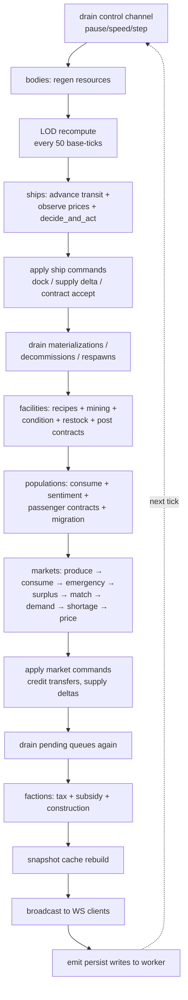
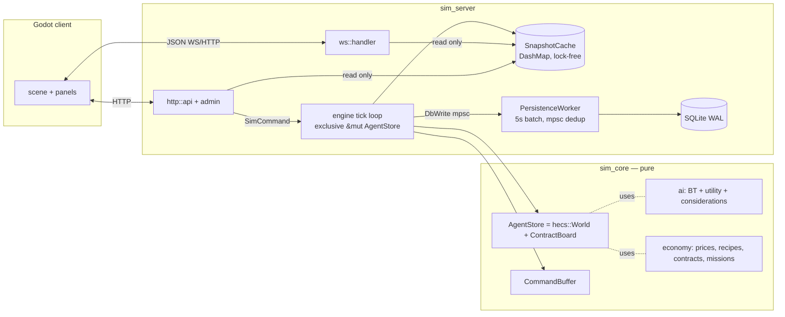
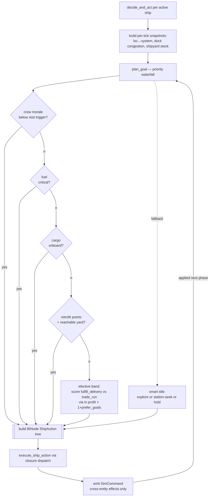
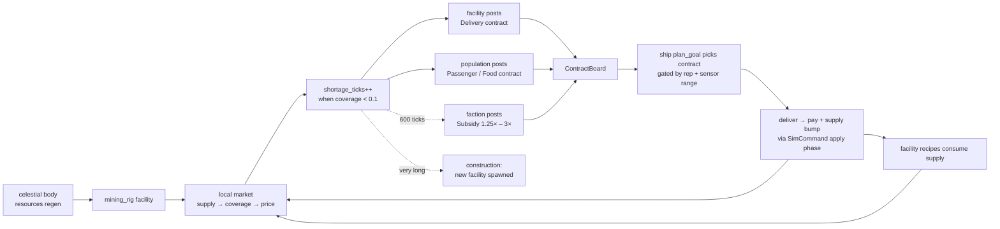
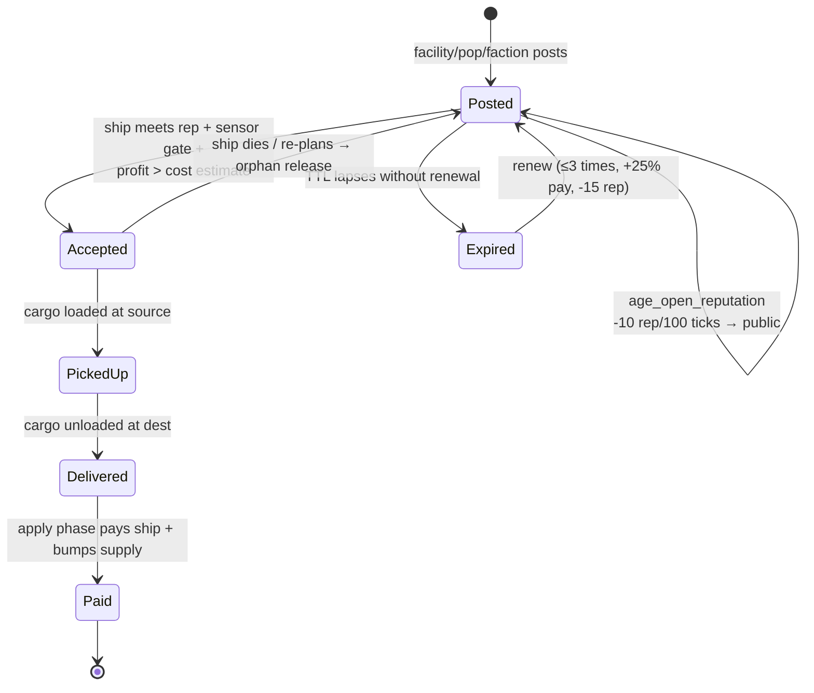
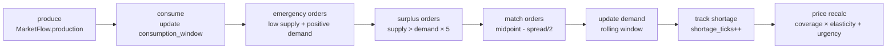
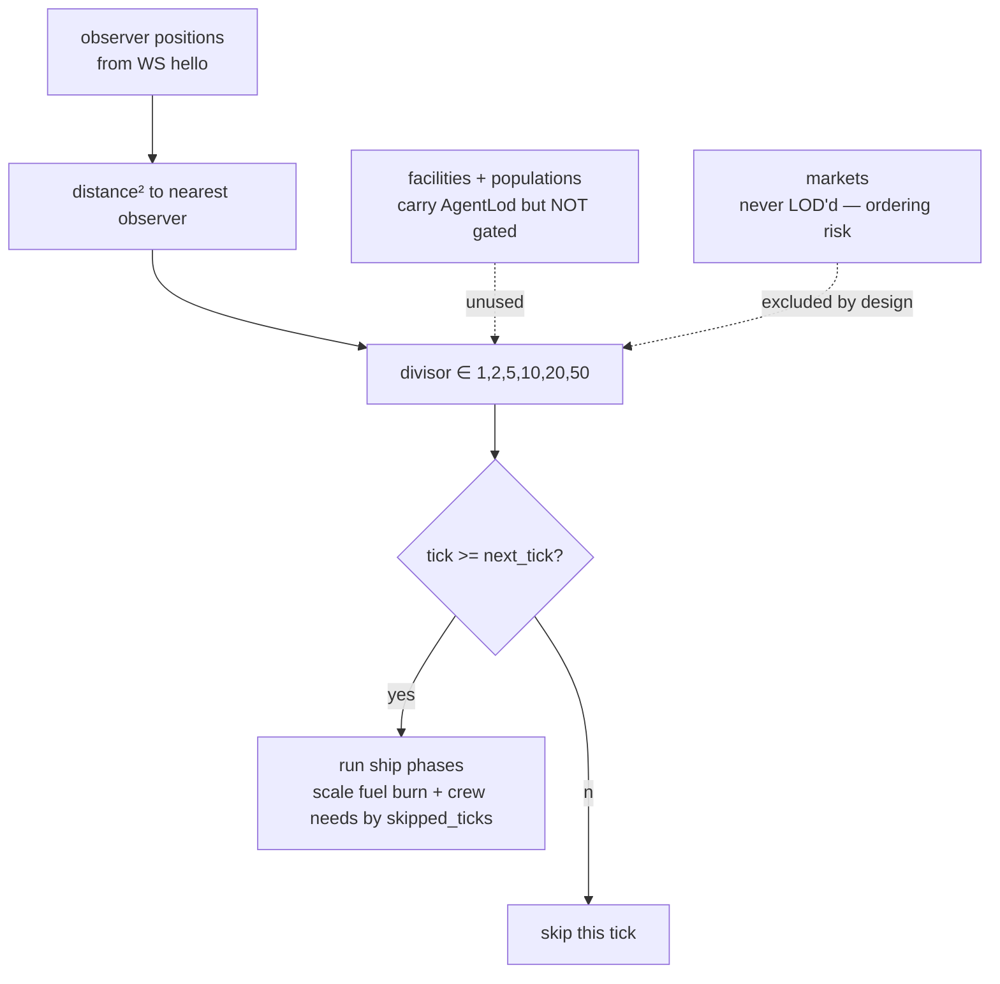
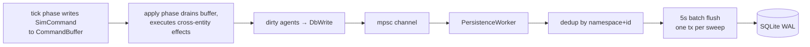

# simulator-rust architecture

Living diagrams of the Rust space-economy simulator. For the per-system behavior table, see the "Systems wired" section of [CLAUDE.md](../CLAUDE.md). For the current improvement backlog, see [plan.md](../plan.md).

> Update rule: when a phase is added to the tick loop, a new contract kind is added, or a new agent type is introduced, update the affected diagram below in the same PR.

---

## 1. Tick loop phase graph

The tick is a fixed sequence of phases with exclusive mutable access to `AgentStore`. No locks, no intra-tick async. Order is hardcoded in `engine::run_tick_loop` and must not be reordered casually — several phases depend on the previous phase's apply step (e.g. markets tick *after* ships+facilities so this tick's supply changes land before price recalc).

---

## 2. Runtime data ownership

`sim_core` is pure (no tokio/sqlx/axum). `sim_server` bridges async IO to the pure world. The tick loop owns `&mut AgentStore` exclusively; HTTP and WS handlers only read from `SnapshotCache`. Persistence is a sibling tokio task consuming a buffered mpsc channel so disk IO never stalls the tick.

---

## 3. Ship decision stack

Strategic layer (utility + priority waterfall in `plan_goal`) picks *which* goal. Tactical layer (`BtNode<ShipAction>` resumable tree) handles *how* to execute it. Dispatch is via a closure in `execute_ship_action` that holds the mutable component borrows for this ship, keeping the BT engine generic and reusable.

---

## 4. Economic feedback loop

The living-economy loop is genuinely closed: shortages propagate to contracts, contracts pull ships, deliveries restore supply, and factions step in (subsidies then construction) when market incentives alone can't close the gap.

---

## 5. Contract lifecycle

All six contract kinds (Delivery / Courier / Passenger / Subsidy / Supply / CrewMission) share this lifecycle. Reputation gates start at 0 / 50 / 70 depending on kind and decay −10 rep per 100 ticks until public. Payment escalates +5% per 50 ticks (cap +100%) to incentivise fulfilment of stale demand.

---

## 6. Market 8-phase tick

Each market runs eight ordered sub-phases per tick. The coverage model treats supply as a *buffer* (not a ratio) so stockpiles stabilise prices rather than depress them. Urgency multiplier ramps 1.0 → 2.5 over a 50-tick shortage window so persistent scarcity keeps pressure climbing.

---

## 7. LOD gating

Observer-driven distance tiers assign each agent a tick divisor (1, 2, 5, 10, 20, 50). A ship outside all observer radii fires every 50 ticks; per-tick accumulators (fuel burn, crew hunger) scale by `skipped_ticks` so total state change over wall-clock matches. Facilities and populations carry `AgentLod` but their tick phases don't gate on it yet — see plan.md Bundle 1.5. Markets are never LOD'd because ordering sensitivity makes skipped ticks unsafe there.

---

## 8. Persistence + command flow

Cross-entity effects go through `SimCommand` (enum, ~40 variants) collected into a `CommandBuffer` per tick. The apply phase drains the buffer and executes atomically. Dirty agents emit `DbWrite` to an mpsc channel; the persistence worker dedups by (namespace, id) and flushes to SQLite every 5 s (or on-demand via admin save).

---

## Cross-references

- [CLAUDE.md](../CLAUDE.md) — Systems wired table (behavior-per-module), crate layout, conventions.
- [SESSION-HANDOFF.md](../SESSION-HANDOFF.md) — fresh-session orientation.
- [plan.md](../plan.md) — bundled improvement roadmap.
