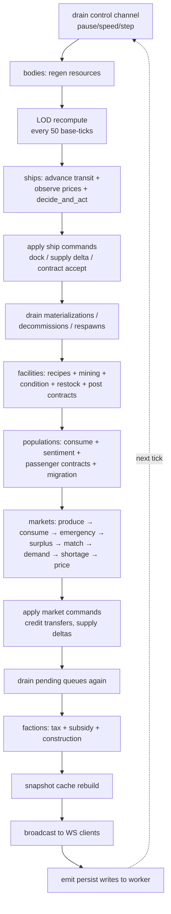
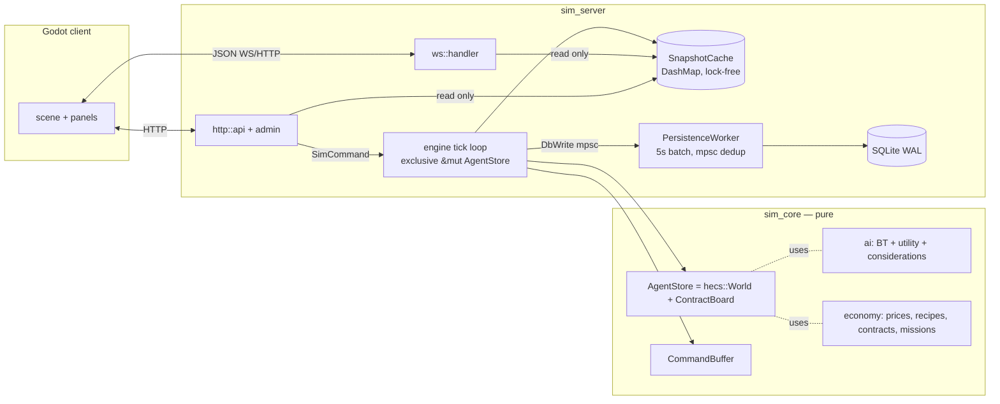
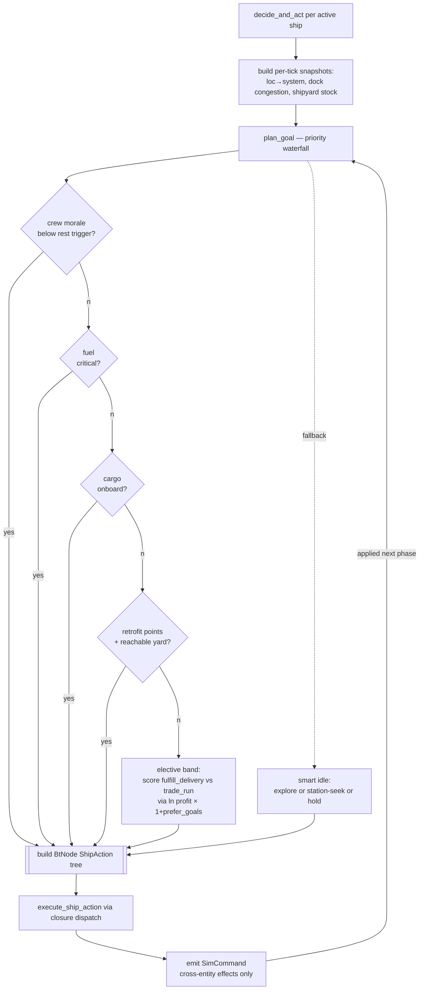
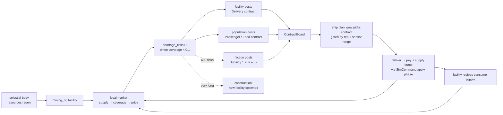
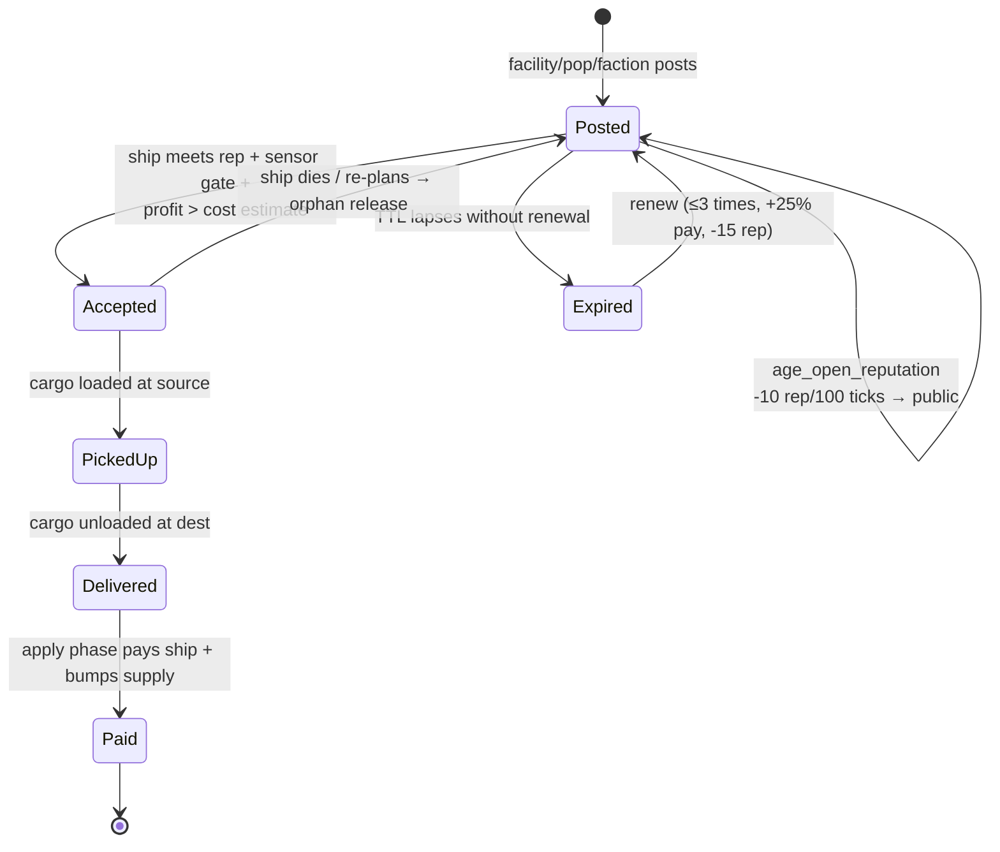
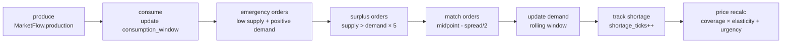
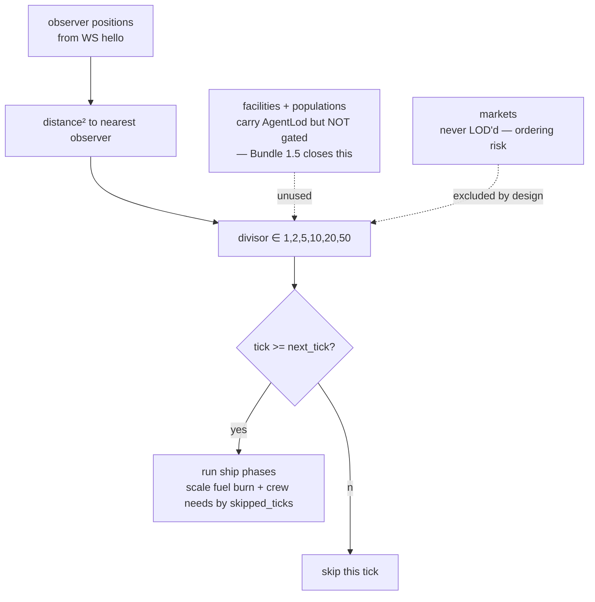
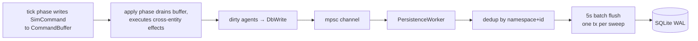

# simulator-rust — fresh-eyes review, bundled for execution

## Context

You asked for a fresh pair of eyes on `simulator-rust/` to:
1. Document the current agent/economy systems with mermaid diagrams.
2. Spot places it could be smarter, more emergent, or architecturally cleaner.

This file is the master plan. It is organized into **bundles** — self-contained chunks of work that can be picked up independently in later sessions. Each bundle has a goal, the concrete items, an order, and a verification approach.

> **Concurrent-edit caveat.** Another Claude is editing the tree right now. Symbol names (`plan_goal`, `tick_populations`, `SimCommand`, `ContractBoard`, etc.) are durable anchors; line numbers and thresholds may drift. Re-read at head before acting.

> **This file will be copied to `simulator-rust/plan.md` as the first step of Bundle 3**, so it's tracked with the code and visible to whoever picks up next.

---

## Bundles at a glance

| # | Bundle | Theme | Effort | Risk |
|---|---|---|---|---|
| 1 | Starter Bundle | Quick wins: causal trace, price decay, personality drift, contract sizing, LOD extension | ~1–2 sessions | Low |
| 2 | Big AI Arc | Utility-scored planner + mid-action replan | ~2–3 sessions | Medium (rewrites `plan_goal`) |
| 3 | Mermaid Docs | Extract Part 5 diagrams into `simulator-rust/docs/ARCHITECTURE.md` + copy this plan in | ~1 session | None |
| 4 | Backlog | Everything else, scoped but unprioritized | As-needed | Varies |

Recommended order: **3 → 1 → 2 → 4**. Docs first so future sessions (and the other Claude) have the shared reference; starter bundle next for low-risk wins; big AI arc when you have a clean session; backlog as appetite dictates.

---

## Bundle 1 — Starter Bundle (low risk, high leverage)

**Goal.** Five small, independent improvements that each visibly improve sim behavior without touching tick-phase order or the BT engine. No single one is architectural; together they push the feel from "mechanical" toward "emergent."

**Items, in suggested implementation order:**

### 1.1 (R) Causal trace endpoint
- **Problem.** Debugging "why did ship X go broke?" is archaeology.
- **Change.** Add `GET /api/debug/ship/:id/trace` that returns the last N `SimCommand` entries mentioning that ship. Command trace ring buffer already exists (`app_state::COMMAND_TRACE_CAPACITY`, `engine::record_command_trace`).
- **Files.** `sim_server/src/http/api.rs` (new route), `sim_server/src/app_state.rs` (expose filtered query).
- **Acceptance.** Spawn a ship, let it trade, query endpoint, see Buy/Deliver/Pay events for that ship only.
- **Effort.** ~1 hour.

### 1.2 (E) Price memory decay
- **Problem.** `ShipMemory.price_knowledge` keeps every price forever → stale routing.
- **Change.** Decay stored prices by age when scoring, or store an EMA. Weight in `trade_opportunity` consideration.
- **Files.** `sim_core/src/ai/considerations.rs::trade_opportunity`, `sim_core/src/agents/ship` (price observation site).
- **Acceptance.** Unit test: observe a price at tick 0, observe a better price at tick 500 for same commodity at different station — ship routes to the fresher source even if raw margin is slightly lower.
- **Effort.** ~2 hours.

### 1.3 (F) Contract quantity scales with shortage depth
- **Problem.** `DELIVERY_CONTRACT_QTY = 50` hardcoded. A market short 500 units spawns 10 serial 50-unit contracts.
- **Change.** Compute `qty = clamp(shortage_magnitude, min_qty, max_qty_by_facility_credits)` at post time.
- **Files.** `sim_core/src/agents/facility::tick_post_contracts`.
- **Acceptance.** Smoke run: watch contract board — big shortages produce one big contract instead of a swarm of small ones.
- **Effort.** ~2 hours.

### 1.4 (D) Personality drift
- **Problem.** Personality is frozen at spawn. No character arc over thousands of ticks.
- **Change.** Nudge axes by ε on key events: completed contract → +profit, near-starvation → +safety, exploration-discovery → +exploration. Clamp to [0,1].
- **Files.** `sim_core/src/ai/personality::Personality` (add `drift` method), hooks in `DeliverContract` apply and `Rest`-timeout path.
- **Acceptance.** Unit test: simulate 100 deliveries, assert `profit` axis increased; simulate 5 near-starvations, assert `safety` axis increased.
- **Effort.** ~3 hours.

### 1.5 (L) Extend LOD gating to facilities + populations
- **Problem.** CLAUDE.md admits facility/pop phases don't LOD-gate. They'll dominate at 10k agents.
- **Change.** Gate `tick_recipes_and_mining`, `tick_restock`, `tick_populations` on `AgentLod::try_fire`; scale any per-tick accumulators (sentiment inertia, crew hunger) by `skipped_ticks`.
- **Files.** `sim_core/src/agents/facility`, `sim_core/src/agents/population`; `AgentLod::try_fire` already supports it.
- **Acceptance.** Spawn 500 facilities with observer present on 50, observer absent on 450 → perf HUD shows facility-phase cost drop proportional. 155 existing tests still pass.
- **Effort.** ~4 hours. Main risk: missed accumulator scaling → slow drift over hours.

**Bundle verification.** `scripts/verify.sh --strict` clean + `WORLD_SPEED=4 scripts/smoke.sh 60` shows no economic regression. Ship-list panel shows visibly more personality variation after 2000 ticks.

---

## Bundle 2 — Big AI Arc (A + B)

**Goal.** Replace the priority waterfall in `plan_goal` with a unified utility scorer and add mid-action replanning. This is the single biggest "AI feel" upgrade available.

### 2.1 (A) Unified utility scoring
- **Problem.** `plan_goal` is a priority cascade. A ship with 1% fuel never considers any contract, even one that passes a refuel station on the way. Opportunities near the path are invisible.
- **Change.** Score every candidate goal in one pass. Low fuel dominates by sheer consideration magnitude (fuel_urgency → 1.0 × safety weight), not by hardcoded bypass. Add compensating considerations: `fuel_on_route`, `morale_on_route`, `reachable_without_refuel`.
- **Files.** `sim_core/src/agents/ship::plan_goal` (rewrite), `sim_core/src/agents/ship::score_goal` (expand), `sim_core/src/ai/considerations` (add new signals), `sim_core/src/ai/utility::best_action` (may need weighting tweaks).
- **Subtasks.**
  1. Define the new ActionSpec set (rest_crew, refuel, sell_cargo, fulfill_delivery, trade_run, retrofit, explore, idle) with factors + directions.
  2. Write per-goal candidate generators (reuse `try_plan_contract`, `try_plan_trade_run`).
  3. Implement combined scorer.
  4. Replace `plan_goal` body. Keep BT builders unchanged — they consume the chosen goal.
  5. Unit tests per goal: starvation-level fuel ⇒ refuel wins; healthy fuel + juicy contract ⇒ contract wins; gate-fuel edge case ⇒ refuel wins by narrow margin.

### 2.2 (B) Mid-action replan on opportunity
- **Problem.** `Running` BT can't pivot. Ship finishes current plan even if a 10× better deal lands.
- **Change.** Each tick, compute current goal's score + best alternative's score. If `alternative > current × 1.25` AND `ticks_since_plan > MIN_COMMIT`, abort BT and replan. Hysteresis + min-commit prevent thrashing.
- **Files.** `sim_core/src/agents/ship::decide_and_act` (add score tracking on `ShipMemory`), planner integration.
- **Acceptance.** Scenario: ship mid-trade run; spawn a high-value subsidy contract on a station it can reach — ship abandons the trade run, picks the contract. Inverse scenario: ship mid-retrofit, juicy trade posted — ship finishes retrofit (retrofits are committed by design).

**Bundle verification.** `scripts/verify.sh --strict` clean, 155 tests pass. Spawn two worlds with same seed, one with waterfall, one with scorer. Qualitatively: scorer fleet shows more opportunistic routing; waterfall fleet shows more lockstep behavior. Perf p50 increase < 200 µs.

**Blast-radius notes.** `plan_goal` is central — almost every BT path starts there. High-value test: make sure the crew-starvation-death-spiral fix from Phase 18k still holds. The waterfall's biological-needs-first behavior must emerge naturally from the new scorer, not be lost.

---

## Bundle 3 — Mermaid Docs

**Goal.** Turn the architecture mermaid into a tracked doc so future sessions share the reference, and copy this plan into the repo.

### 3.1 Copy `plan.md` into repo
- Copy this file to `simulator-rust/plan.md`.
- Add it to `.gitignore` review — probably tracked, not ignored.

### 3.2 Create `simulator-rust/docs/ARCHITECTURE.md`
Contains eight mermaid diagrams (see Part 5 below), each with a one-paragraph caption. Cross-links to CLAUDE.md for the "Systems wired" table.

### 3.3 Add link from `simulator-rust/CLAUDE.md`
Single-line pointer near the top: "See [docs/ARCHITECTURE.md](./docs/ARCHITECTURE.md) for diagrams of the tick loop, AI stack, and economy."

**Verification.** `gh pr checks` or whatever renders — view the file on GitHub, confirm mermaid renders.

**Effort.** ~30 minutes once the other Claude is done.

---

## Bundle 4 — Backlog (scoped, unprioritized)

Each item is an independent change we might pick up later. Ordered only by the section they belong to.

### AI / decision-making
- **(C) GOAP / HTN planner.** Synthesize multi-step plans instead of hand-authoring BTs. Defer until goal count doubles. `sim_core/src/ai/planner` (new). High effort.

### Economy
- **(G) Money sink / inflation anchor.** Pick one: docking-fee burn, wage void sink, faction treasury ceiling. Low-medium effort. **Important** for multi-day runs.
- **(H) Facility profitability gate on recipes.** Skip negative-margin batches. `facility::tick_recipes_and_mining`. Medium effort.
- **(I) Reverse-auction contracts.** Ships bid price; facility picks. High effort. Probably after G + F.
- **(J) Bundled convoy contracts.** Aggregate nearby same-commodity demand into one big contract. Medium effort.
- **(K) Population wealth as a real variable.** Wire wages → wealth → growth → consumption. Medium effort; test carefully.

### Scalability / engine
- **(M) Incremental snapshot cache.** Dirty-set rebuild instead of full scan. Medium-high effort.
- **(N) Rayon on ship phase.** Architecture already supports it (no cross-ship writes within phase). Medium effort.
- **(O) Spatial grid for LOD + proximity queries.** Replace O(n × observers) with grid lookup. `sim_core/src/spatial/` skeleton exists. Medium effort.
- **(P) Contract board index.** Bucket by (rep-tier, destination-system). Low effort.

### Observability / ergonomics
- **(Q) Parameterize magic numbers.** `WorldTuning` struct, admin-tweakable. Low-medium effort, lots of touchpoints.
- **(S) `MarketCrisis` / `FacilityStarving` events.** Threshold-crossing events for Godot to surface. Low effort.

---

## Part 5 — Architecture as-is (the diagrams for Bundle 3)

### 5.1 Tick loop phase graph

### 5.2 Runtime data ownership

### 5.3 Ship decision stack

### 5.4 Economic feedback loop

### 5.5 Contract lifecycle

### 5.6 Market 8-phase tick

### 5.7 LOD gating (ship-only today)

### 5.8 Persistence + command flow

---

## Part 6 — What's good that we should preserve

When any of these bundles touch core systems, these properties must survive.

- Strategic-vs-tactical AI split (utility picks *which*, BT handles *how*).
- `BtNode<A>` generic action type — no fn-pointer capture problem.
- Command buffer: same-entity mutations inline, cross-entity via `SimCommand`.
- hecs single-writer tick — no locks on agent state.
- Coverage-model pricing with urgency multiplier.
- Reputation gating + age-decay — natural on-ramp for new ships.
- Congestion-aware rest (Phase 18L) and multi-facility dock fallback (Phase 18k).
- Deterministic replay (no wall-clock reads in sim_core).

---

## Part 7 — Generic verification checklist

For every bundle:

- `scripts/verify.sh --strict` clean (155 tests pass + clippy strict).
- `WORLD_SPEED=4 scripts/smoke.sh 60` runs without economic regression (no runaway inflation / mass starvation / stuck contracts).
- `/api/health` p50 tick compute within 200 µs of baseline (~1 ms).
- For AI changes: ship-list panel shows visible diversity in goal selection after 2000 ticks.
- For economy changes: contract board panel shows healthy turnover (no contracts stuck > 5000 ticks).

---

## Part 8 — Pickup instructions for next session

1. `git status` / `git diff` — see what the other Claude changed.
2. Reconcile any conflicts between this plan and current head. Symbol names are stable; line numbers may have moved.
3. Pick a bundle (recommend **3 → 1 → 2 → 4**).
4. For Bundle 1 and 2, produce a per-item implementation sub-plan before coding (one file per item, e.g. `.claude/plans/bundle-1-item-R-causal-trace.md`).
5. For Bundle 3, just do it — ~30 min of file moves.

Session boundaries are natural per-item. Don't try to do more than one Bundle-1 item per session unless they're obviously trivial.
